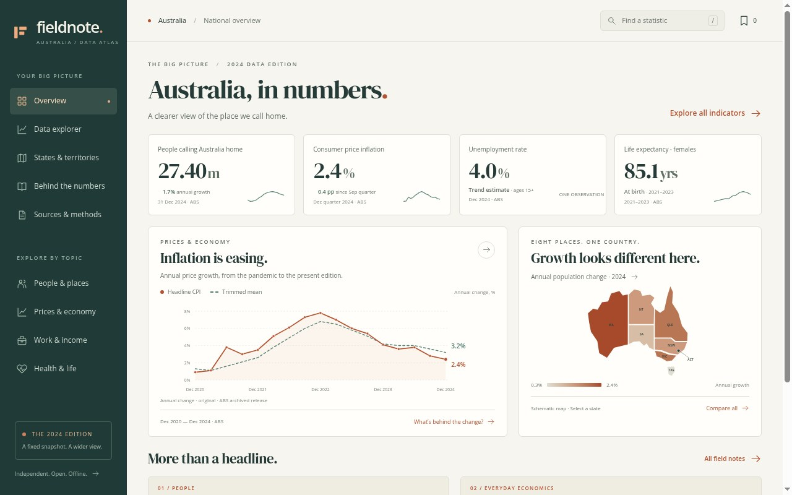

[](https://make.fun/bounty/best-national-statistics-site-20261126-0539)
[](https://make.fun/bounty/best-national-statistics-site-20261126-0539)
[](https://make.fun/bounty/best-national-statistics-site-20261126-0539)

# Fieldnote · Australia

An independent atlas of Australian statistics: **a clearer view of the place we call home.** Built from original HTML, CSS, JavaScript and SVG, with no dependencies, remote fonts, analytics or runtime network requests.



## Explore

- A national overview with sourced population, inflation, unemployment and life expectancy figures.
- Eight indicator pages with definitions, reference periods, interactive charts, exact tables and CSV exports.
- Eight state and territory profiles, a linked schematic map, selectable comparison measures, sorting and regional exports.
- Four topic collections and two explanatory field notes.
- Full-site search, topic and text filters, local bookmarks, accessible controls and a phone layout.
- An offline sourcebook explaining provenance, geography, revision policy, rounding and comparability.

## Run locally

Requires Node.js 22.18+; this environment uses the explicit TypeScript flag. Nothing needs installing.

Some minimal Alpine Node builds omit TypeScript support entirely (`ERR_NO_TYPESCRIPT`). For those development environments, install the optional `tsx` loader (`npm install --no-save tsx`) and prefix the commands below with `NODE_OPTIONS='--import=tsx'`. The browser application itself has no package dependencies. Verification in the development environment used an isolated loader outside this repository.

```sh
npm start
```

Open `http://127.0.0.1:8080`. For another port:

```sh
node --experimental-strip-types serve.ts --port 8090
```

All site assets live in `app/`. Serve that directory as a static website; hash routes also work when hosted in a subdirectory. External ABS links are optional, labelled as requiring internet, and never fetched by the app.

## Data edition and provenance

**This is a fixed 2024 data edition, not a live statistics service.** Dates are displayed beside figures. The labour data is explicitly **trend**, not seasonally adjusted. Population includes annual growth through December 2024; CPI has 17 quarterly observations from December 2020 through December 2024. Life expectancy uses overlapping three-year periods, 2011–2013 through 2021–2023. Labour indicators contain a single verified December 2024 observation rather than an invented history.

All figures are transcribed from these archived Australian Bureau of Statistics releases:

| Release | Reference period | Published |
| --- | --- | --- |
| [National, state and territory population](https://www.abs.gov.au/statistics/people/population/national-state-and-territory-population/dec-2024) | December 2024 | 19 June 2025 |
| [Consumer Price Index, Australia](https://www.abs.gov.au/statistics/economy/price-indexes-and-inflation/consumer-price-index-australia/dec-quarter-2024) | December quarter 2024 | 29 January 2025 |
| [Labour Force, Australia](https://www.abs.gov.au/statistics/labour/employment-and-unemployment/labour-force-australia/dec-2024) | December 2024 | 16 January 2025 |
| [Life expectancy](https://www.abs.gov.au/statistics/people/population/life-expectancy/2021-2023) | 2021–2023 | 8 November 2024 |

The population chart shows annual growth, not population level. State populations are rounded to 100; national totals include Other Territories. Migration's 76.4% contribution is calculated from unrounded figures. The map is an original schematic with approximate boundaries and an enlarged ACT, not an authoritative geographic product. No ABS logo or government identity is used.

## Verify and reproduce

```sh
npm test
npm run test:browser
npm run capture
npm run verify
gitleaks detect --source . --no-git
```

Browser checks require a local Chromium executable, defaulting to `/usr/bin/chromium`; override with `CHROMIUM`. The dependency-free DevTools test exercises routes, search, table/chart switches, time windows, measures, downloads, bookmarks, state filtering and phone navigation. After the initial local load it disables network access and checks that all interactions still work. It rejects external requests, missing assets, browser exceptions and horizontal overflow.

`npm run capture` also captures the four untouched JPEG browser renders described in `shots.json`. The first is the cover. Three are 1280 × 800; the phone is 390 × 844. Each is under 256 KiB. No screenshot is composited or edited.

`npm run verify` checks the vendor SHA-256, packages twice into temporary directories, compares all file hashes and independently rebuilds both dossiers. It is a local integrity check, not an official competition grade or transcript-gate result.

## Package the entry

```sh
mkdir -p out
MAKEFUN_OUTPUT_DIR=out npm run build
```

The grading runtime invokes root `main.ts` with TypeScript support and defaults to `/output`. The program copies `app/` and `screenshots/`, then generates `dossier.json` using the unchanged kit library. A source-bundle/transcript bundle is intentionally outside these build commands.

## Structure

| Path | Purpose |
| --- | --- |
| `app/data.js` | Archived observations, definitions, provenance and CSV serialization |
| `app/charts.js` | Accessible SVG charts, state comparisons and schematic atlas |
| `app/views.js` | Substantive page rendering and search result content |
| `app/main.js` | Hash routing and working local interactions |
| `app/style.css` | Original responsive visual system and print styles |
| `main.ts` | Deterministic competition packaging |
| `serve.ts` | Local static server with traversal protection |
| `tests/` | Data, browser and packaging verification |

## License

Original implementation: MIT, see `LICENSE`. The unchanged `vendor/makefun-frontend.ts` is supplied by make.fun under the starter's MIT license; see `THIRD_PARTY_NOTICES.md`. The bundled DM Serif Display Latin font uses the SIL Open Font License in `app/fonts/OFL.txt`; it is served locally. Statistics are attributed to ABS; consult the source release and ABS Creative Commons terms before reuse. Fieldnote is independent and is not affiliated with ABS.
